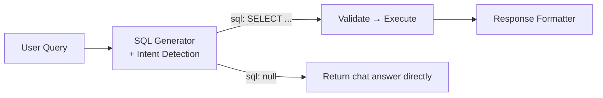
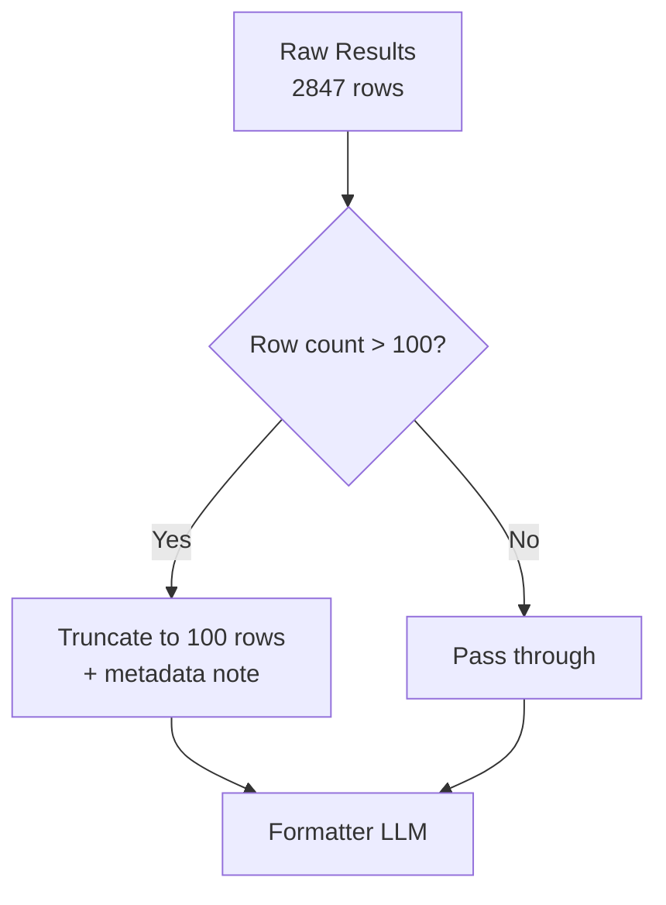
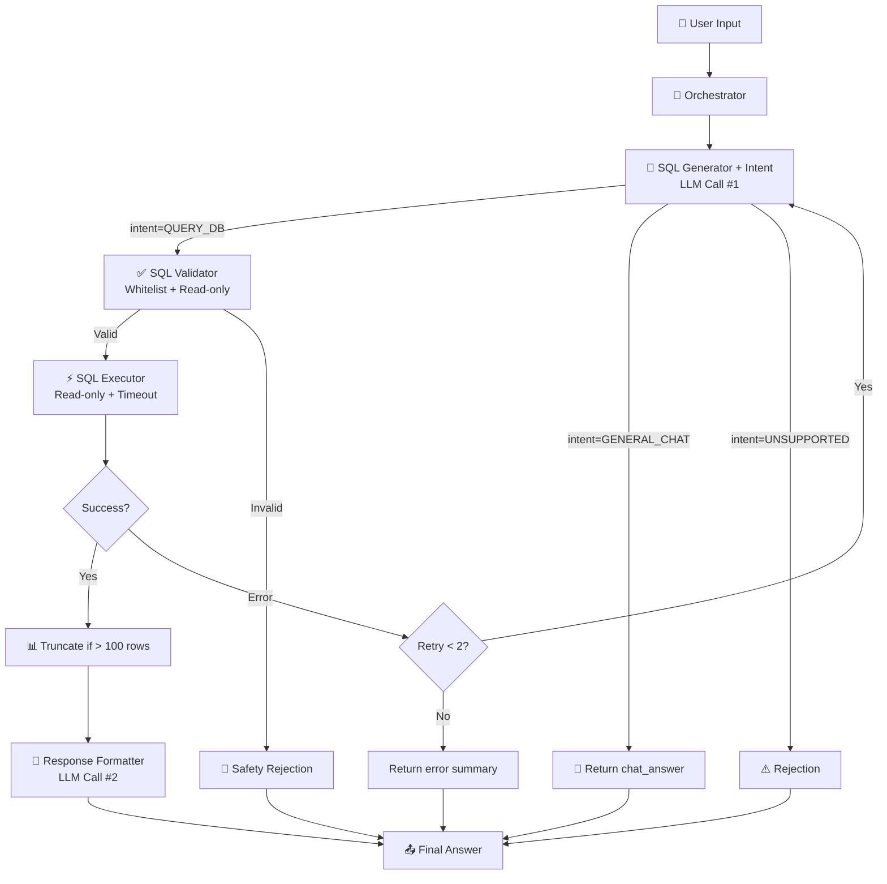
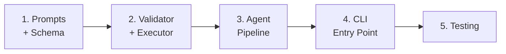

# Architecture Review — AgenticSQL Orchestration Agent

## 1. Executive Summary

The proposed design follows a **3-stage LLM pipeline** (Intent → SQL → Format) with deterministic validation and retry logic. While the overall structure is sound, this review identifies **7 concerns** ranging from performance overhead to security gaps, and proposes targeted improvements.

**Verdict:** The design is a solid foundation. Address the issues below before implementation to avoid costly rework.

---

## 2. Concerns & Recommendations

### 🔴 CONCERN #1: Three LLM Calls Per Query Is Expensive

**Problem:** Every query makes 3 round trips to Groq:
1. Intent classification
2. SQL generation
3. Response formatting

For the **dominant use case** (database queries), the intent classifier adds ~500ms-1s latency and token cost for something that is true 90%+ of the time.

**Recommendation:** **Merge intent classification into the SQL generation step.** Use a single LLM call that either:
- Returns a SQL query (if the question is about the database), OR
- Returns a conversational answer (if it's not)

This collapses the pipeline from 3 calls to **2 calls** for the happy path:



The structured output schema becomes:
```json
{
  "intent": "QUERY_DB | GENERAL_CHAT | UNSUPPORTED",
  "sql": "SELECT ... | null",
  "chat_answer": "null | A general answer...",
  "explanation": "Why this SQL/answer"
}
```

**Impact:** ~33% reduction in latency and token cost. Simpler code.

---

### 🔴 CONCERN #2: Large Result Sets Will Break the Formatter

**Problem:** The database contains **~600,000 transaction rows**, **~750+ accounts**, and **~200 loans**. A query like *"show me all transactions"* or even *"list transactions for customer 42"* could return thousands of rows. Sending this to the Response Formatter LLM call will:
- Exceed the LLM context window (~8K tokens for typical Groq models)
- Cause token cost to explode
- Return truncated/garbage output

**Recommendation:** Add a **result truncation layer** between the executor and formatter:

1. **Hard limit:** Cap SQL results at **100 rows** by appending `LIMIT 100` if no LIMIT clause exists
2. **Summary mode:** If row count > 100, include a metadata prefix: *"Showing 100 of 2,847 results"*
3. **Aggregate encouragement:** In the SQL generation prompt, instruct the LLM to prefer aggregate queries (COUNT, SUM, AVG, GROUP BY) over raw row dumps



---

### 🔴 CONCERN #3: SQL Validator Blacklist Has Security Gaps

**Problem:** The proposed blacklist only covers standard DML/DDL: `DROP, DELETE, UPDATE, INSERT, ALTER, CREATE, TRUNCATE`. SQLite has additional dangerous capabilities:

| Command | Risk |
|---|---|
| `PRAGMA` | Can change journal mode, integrity settings, etc. |
| `ATTACH DATABASE` | Can attach arbitrary files |
| `.load` / LOAD_EXTENSION | Can execute arbitrary C code |
| `VACUUM` | Can write to arbitrary paths |
| CTEs with recursive infinite loops | Denial of service |
| `REPLACE` | Syntactic sugar for DELETE + INSERT |

**Recommendation:** Use a **whitelist approach instead of a blacklist:**

1. **Primary defense:** Open the database in **read-only mode** (`sqlite:///agentic_sql.db?mode=ro`)
2. **Secondary defense:** Parse the SQL with `sqlparse` and verify:
   - Statement type is `SELECT` only
   - No subqueries that contain non-SELECT statements
3. **Tertiary defense:** Keyword blacklist as a final catch-all, but expanded to include: `PRAGMA, ATTACH, DETACH, LOAD_EXTENSION, VACUUM, REPLACE, REINDEX, ANALYZE`
4. **Query timeout:** Set a 10-second execution timeout to prevent DoS via expensive queries

```python
# Read-only connection (primary defense)
engine = create_engine("sqlite:///file:agentic_sql.db?mode=ro&uri=true")
```

---

### 🟡 CONCERN #4: Schema Injection Strategy Needs Optimization

**Problem:** `SQLDatabase.get_table_info()` dumps the full DDL + sample rows for all 8 tables. With the banking schema, this can be **2,000+ tokens**, consuming a significant portion of the context window.

**Recommendation:** Use a **two-tier schema strategy:**

1. **Compact schema** for the SQL generator prompt — table names and column names only (no types, no sample data, no constraints). This is ~400 tokens.
2. **Full schema** available via a follow-up if the LLM needs clarification (rare).

Example compact schema:
```
Tables:
- branches: id, name, phone, email, created_at
- addresses: id, street, city, state, postal_code, country
- phone_numbers: id, address_id, number, label
- customers: id, first_name, last_name, email, phone, date_of_birth, address_id, created_at
- employees: id, first_name, last_name, email, phone, role, branch_id, hire_date, created_at
- accounts: id, account_number, account_type, balance, currency, customer_id, branch_id, opened_at, status
- account_managers: id, employee_id, account_id, assigned_at
- transactions: id, account_id, transaction_type, amount, currency, description, reference_number, created_at
- loans: id, customer_id, account_id, loan_type, principal, interest_rate, term_months, start_date, end_date, status, created_at

Foreign Keys:
- customers.address_id → addresses.id
- employees.branch_id → branches.id
- accounts.customer_id → customers.id
- accounts.branch_id → branches.id
- account_managers.employee_id → employees.id
- account_managers.account_id → accounts.id
- transactions.account_id → accounts.id
- loans.customer_id → customers.id
- loans.account_id → accounts.id
```

This is more token-efficient and gives the LLM exactly what it needs.

---

### 🟡 CONCERN #5: Error Recovery Loop Needs Bounds

**Problem:** The retry loop feeds error messages back to the SQL generator. While 2 retries is reasonable, there's no circuit breaker for **repeated identical failures** — the LLM might generate the same wrong SQL twice.

**Recommendation:**
1. Track previous SQL attempts and reject duplicates
2. On the second retry, include ALL previous attempts + errors in the prompt, not just the latest
3. If all retries fail, return a helpful message including what was attempted:

```python
if attempt_sql == previous_sql:
    break  # Don't retry with the same query
```

---

### 🟡 CONCERN #6: No Observability / Logging

**Problem:** The design has no logging or tracing. When a query fails in production, there's no way to debug what happened at each stage.

**Recommendation:** Add structured logging at each pipeline stage:

```python
import logging
logger = logging.getLogger("agenticSQL")

# At each stage:
logger.info("Intent classified", extra={"intent": result.intent, "confidence": result.confidence})
logger.info("SQL generated", extra={"sql": sql, "attempt": attempt_num})
logger.info("SQL executed", extra={"row_count": len(rows), "duration_ms": elapsed})
```

This is cheap to implement and invaluable for debugging.

---

### 🟢 CONCERN #7: Module Granularity May Be Overkill

**Problem:** The proposed structure has 7 files in the `orchestrator/` package for what is fundamentally a ~200-line linear pipeline:
```
orchestrator/
├── __init__.py
├── agent.py
├── intent.py
├── sql_generator.py
├── sql_validator.py
├── sql_executor.py
├── formatter.py
└── prompts.py
```

**Recommendation:** Consider a simpler 3-file structure for the initial implementation:

```
orchestrator/
├── __init__.py
├── agent.py           # Main orchestrator + pipeline logic
├── prompts.py         # All prompt templates
└── validators.py      # SQL validation + execution (deterministic code)
```

The LLM interaction logic (intent, SQL generation, formatting) all live in `agent.py` since they share the same `ChatGroq` instance and follow the same pattern. This avoids over-abstraction for a single-purpose pipeline. You can always split later if the codebase grows.

---

## 3. Revised Architecture

Incorporating all recommendations:



### Key Changes from Original Design:
| Aspect | Original | Revised |
|--------|----------|---------|
| LLM calls (happy path) | 3 | **2** |
| SQL safety | Blacklist only | **Read-only DB + whitelist parsing + expanded blacklist** |
| Large results | Not handled | **LIMIT 100 + truncation metadata** |
| Schema injection | Full DDL + samples | **Compact schema (~400 tokens)** |
| Module count | 7 files | **3 files** |
| Logging | None | **Structured logging at each stage** |
| Retry dedup | None | **Track + reject duplicate SQL attempts** |

---

## 4. Implementation Plan



### Updated Todo List:

1. **Create `orchestrator/prompts.py`** — Define compact schema string + all prompt templates (SQL generator + intent, response formatter)
2. **Create `orchestrator/validators.py`** — SQL whitelist validator + read-only executor with timeout + result truncation
3. **Create `orchestrator/agent.py`** — `OrchestratorAgent` class with 2-call pipeline, structured output models (Pydantic), retry loop with dedup
4. **Create `orchestrator/__init__.py`** — Export `OrchestratorAgent`
5. **Update `app.py`** — CLI entry point that takes a query argument and runs the orchestrator
6. **Update `requirements.txt`** — Add `python-dotenv`, `pydantic`, `sqlparse`
7. **Create `tests/test_orchestrator.py`** — Unit tests for validator, integration test for full pipeline

---

## 5. Open Questions for Discussion

1. **Should the agent support multi-turn conversation?** Current design is stateless (single query → single answer). If multi-turn is needed, we'd add a conversation history buffer.

2. **Should there be a CLI interface or a web API (FastAPI)?** The current `app.py` is a simple script. A FastAPI endpoint would make this more usable.

3. **Should the response formatter be optional?** For simple COUNT/SUM queries, the raw result might be sufficient without a second LLM call, saving latency.
