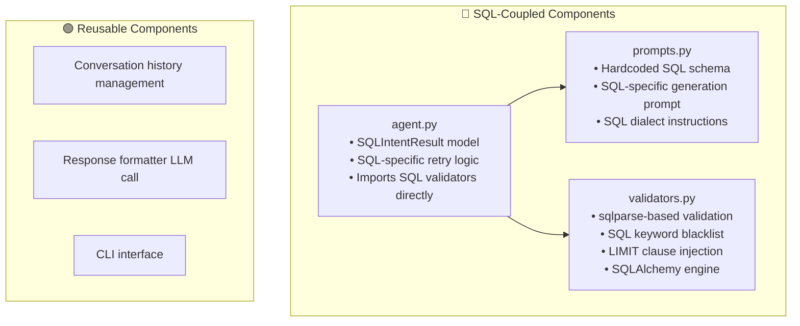
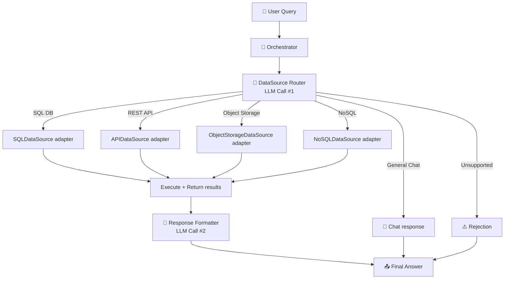
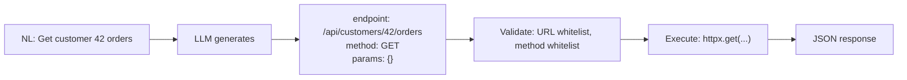
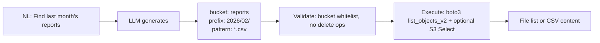
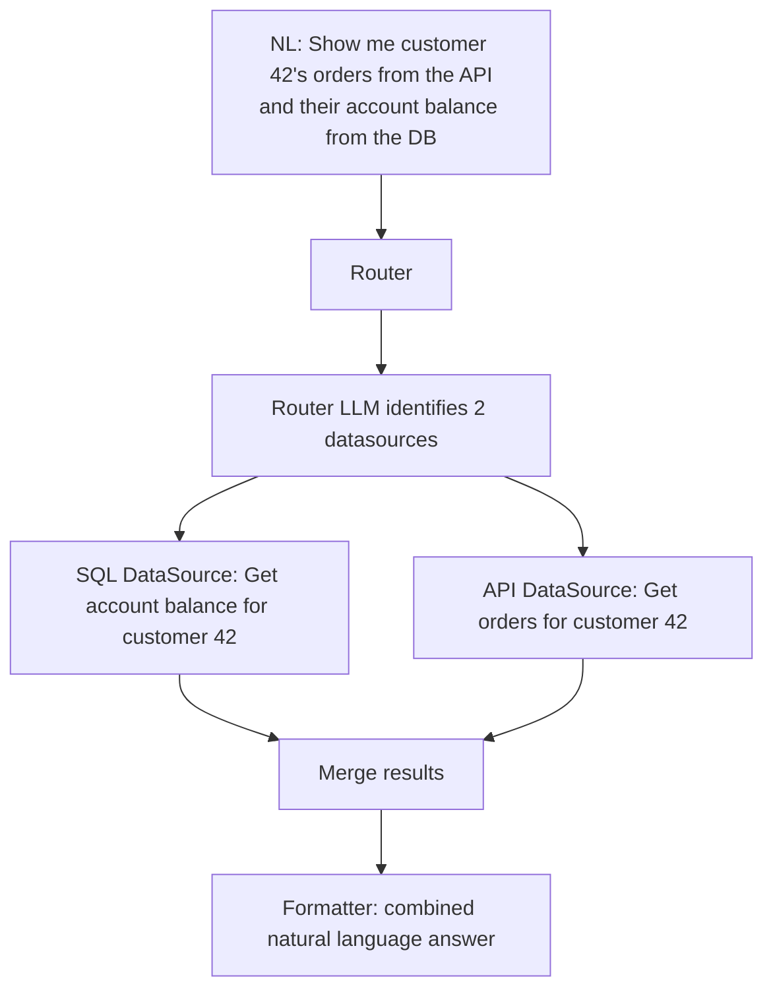
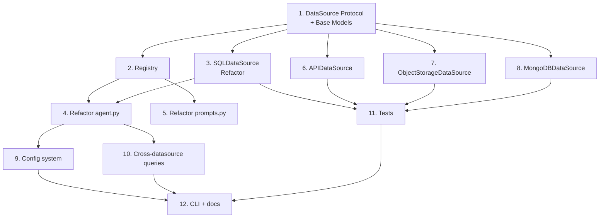

# Multi-Datasource Scaling Design

## 1. Problem Statement

The current AgenticSQL orchestrator is hardcoded to a single datasource (SQLite via SQLAlchemy). The goal is to scale it to support **multiple heterogeneous datasources**:

| Datasource Type | Example | Query Language |
|---|---|---|
| Relational DB (current) | SQLite, PostgreSQL, MySQL | SQL |
| REST API | Internal microservices, third-party APIs | HTTP endpoint + params/body |
| Object Storage | S3, GCS, Azure Blob | Key/prefix patterns, or SQL-like (S3 Select, Athena) |
| NoSQL | MongoDB, DynamoDB, Redis | MongoDB query docs, DynamoDB PartiQL, etc. |

---

## 2. Current Coupling Analysis

Three files contain datasource-specific logic that needs abstraction:



**Coupling score: ~70% of the code is SQL-specific.** The conversation history, response formatting, CLI, and orchestration flow are reusable.

---

## 3. Target Architecture: Strategy Pattern with DataSource Adapters



### Core Abstraction: `DataSource` Protocol

```python
from typing import Protocol

class DataSource(Protocol):
    name: str                    # e.g., "banking_sql", "customer_api"
    description: str             # Human-readable purpose (used in routing prompt)

    def get_schema_description(self) -> str:
        """Return a compact schema/capability description for LLM prompts."""
        ...

    def generate_query(self, nl_query: str, history: list, error_context: str | None) -> QueryResult:
        """LLM call: convert NL → native query for this datasource."""
        ...

    def validate_query(self, query: str) -> ValidationResult:
        """Deterministic safety check (datasource-specific rules)."""
        ...

    def execute_query(self, query: str) -> ExecutionResult:
        """Execute the validated query and return structured results."""
        ...
```

Each datasource type implements this protocol with its own:
- Schema description format
- Query generation prompt
- Validation rules
- Execution logic

### DataSource Registry

```python
class DataSourceRegistry:
    """Registry of all available datasources. Used by the router to select the right one."""

    def __init__(self):
        self._sources: dict[str, DataSource] = {}

    def register(self, source: DataSource) -> None:
        self._sources[source.name] = source

    def get(self, name: str) -> DataSource:
        return self._sources[name]

    def get_routing_context(self) -> str:
        """Build a description of all datasources for the router LLM prompt."""
        lines = []
        for name, source in self._sources.items():
            lines.append(f"- {name}: {source.description}")
        return "\n".join(lines)
```

### Updated Router Prompt

```
You are a query router for a multi-datasource system.

Available datasources:
{registry.get_routing_context()}

Determine which datasource can best answer the user's question.

Respond in JSON:
{
  "intent": "QUERY | GENERAL_CHAT | UNSUPPORTED",
  "datasource": "datasource_name | null",
  "reasoning": "..."
}
```

---

## 4. Adapter Designs per Datasource

### 4a. SQL DataSource (refactor of current code)

This is a **direct refactor** of the existing `validators.py` and SQL-related prompts into the `DataSource` interface.

| Method | Implementation |
|---|---|
| `get_schema_description()` | Returns the compact SQL schema (from current `prompts.py`) |
| `generate_query()` | LLM call with SQL generation prompt (current logic) |
| `validate_query()` | sqlparse whitelist + blacklist (current `validators.py`) |
| `execute_query()` | SQLAlchemy read-only execution (current `validators.py`) |

**Effort:** Refactor + rewrap existing code. Minimal new logic.

### 4b. REST API DataSource



| Method | Implementation |
|---|---|
| `get_schema_description()` | OpenAPI spec summary or manual endpoint catalog |
| `generate_query()` | LLM generates `{endpoint, method, params, body}` |
| `validate_query()` | Whitelist of allowed base URLs, methods (GET only?), rate limiting |
| `execute_query()` | `httpx` HTTP client with timeout |

**Key challenge:** The LLM needs a clear API catalog (similar to an OpenAPI spec) to know which endpoints exist and what parameters they accept.

### 4c. Object Storage DataSource



| Method | Implementation |
|---|---|
| `get_schema_description()` | Bucket/prefix structure + file type descriptions |
| `generate_query()` | LLM generates `{bucket, prefix, pattern, select_expression?}` |
| `validate_query()` | Bucket whitelist, read-only operations only |
| `execute_query()` | `boto3` S3 client (list_objects, get_object, S3 Select) |

**Key challenge:** Object storage is unstructured — the LLM needs metadata about what's stored where (a catalog/manifest).

### 4d. NoSQL DataSource (MongoDB example)

```mermaid
flowchart LR
    NL["NL: Find orders > $500 this month"] --> LLM["LLM generates"]
    LLM --> Q['db.orders.find({amount: {$gt: 500}, date: {$gte: ...}})']
    Q --> V["Validate: read-only ops only, no $where, no JS execution"]
    V --> E["Execute: pymongo find()"]
    E --> R["Document list"]
```

| Method | Implementation |
|---|---|
| `get_schema_description()` | Collection names + sample document structure (field names + types) |
| `generate_query()` | LLM generates MongoDB query document as JSON |
| `validate_query()` | Whitelist `find`/`aggregate` only; block `$where`, `$function`, `mapReduce` |
| `execute_query()` | `pymongo` client with read preference |

**Key challenge:** MongoDB query syntax is non-trivial for LLMs — needs rich few-shot examples.

---

## 5. Cross-Datasource Queries

Some user questions may span multiple datasources. There are two strategies:

### Strategy A: Sequential Fan-Out (Simpler)



### Strategy B: Single Coordinator (More Complex)

An LLM-powered "planner" that decomposes the query into sub-tasks, executes them in dependency order, and synthesizes the results. This is essentially a **ReAct/Plan-and-Execute agent**.

**Recommendation:** Start with Strategy A (sequential fan-out). It covers 90% of use cases without the complexity of a full planning agent.

---

## 6. Proposed File Structure

```
orchestrator/
├── __init__.py
├── agent.py              # Orchestrator pipeline (mostly reusable — refactor)
├── prompts.py            # Router prompts + formatter prompt (refactored)
├── registry.py           # DataSourceRegistry
├── datasource.py         # DataSource protocol + base models (ValidationResult, ExecutionResult, QueryResult)
├── datasources/
│   ├── __init__.py
│   ├── sql.py            # SQLDataSource (refactored from current validators.py + prompts)
│   ├── rest_api.py       # APIDataSource
│   ├── object_storage.py # ObjectStorageDataSource
│   └── nosql_mongo.py    # MongoDBDataSource
└── config.py             # Datasource registration + connection config
```

---

## 7. Effort Breakdown

### Work Items

| # | Work Item | Dependency | Description |
|---|---|---|---|
| 1 | Define DataSource protocol + base models | None | Create `datasource.py` with the `DataSource` Protocol, `QueryResult`, `ValidationResult`, `ExecutionResult` base dataclasses. These are the contracts every adapter must implement. |
| 2 | Create DataSourceRegistry | #1 | Create `registry.py` — register/deregister datasources, generate routing context string for LLM. |
| 3 | Refactor current SQL code into SQLDataSource adapter | #1 | Move existing SQL logic from `validators.py` and SQL-specific prompts from `prompts.py` into `datasources/sql.py` implementing the `DataSource` protocol. This is a move+reshape, not new functionality. |
| 4 | Refactor agent.py to use DataSource protocol | #1, #2, #3 | Replace hardcoded SQL calls with `registry.get(datasource_name)` → adapter method calls. Update the intent model to include `datasource` field. Update retry loop to be datasource-agnostic. |
| 5 | Refactor prompts.py — Router prompt | #2 | Replace SQL-specific prompt with a generic router prompt that uses `registry.get_routing_context()`. Keep the formatter prompt mostly as-is. |
| 6 | Implement APIDataSource adapter | #1 | Implement REST API adapter — needs: API catalog config format, query generation prompt, URL/method whitelist validator, httpx executor. |
| 7 | Implement ObjectStorageDataSource adapter | #1 | Implement S3/GCS adapter — needs: bucket/prefix catalog config, query generation prompt, bucket whitelist validator, boto3 executor. |
| 8 | Implement MongoDBDataSource adapter | #1 | Implement MongoDB adapter — needs: collection schema config, query generation prompt, read-only operation validator, pymongo executor. |
| 9 | Datasource configuration system | #2 | Create `config.py` or YAML/JSON config for registering datasources with connection details at startup. |
| 10 | Cross-datasource query support | #4 | Enable the router to select multiple datasources for a single query, execute in parallel/sequence, merge results before formatting. |
| 11 | Update tests | #3-#8 | Unit tests per adapter + integration tests for the full pipeline with each datasource type. |
| 12 | Update CLI + docs | #4 | Update `app.py` for datasource config, update README. |

### Dependency Graph



### Phased Delivery

#### Phase 1: Core Abstraction + SQL Refactor (Items 1-5, 9)

Refactor the existing working codebase into the adapter pattern without adding new datasources. After this phase, the system works exactly as before but through the `DataSource` protocol.

**This is the critical phase** — it's the foundation everything else depends on. Done wrong, every subsequent adapter will fight the abstraction.

#### Phase 2: First New Adapter — REST API (Item 6)

Add the REST API datasource as the first new adapter. This validates the abstraction design: if the API adapter fits cleanly, the pattern works.

#### Phase 3: Remaining Adapters (Items 7, 8)

Add Object Storage and NoSQL adapters. By this point the pattern is proven and these are largely formulaic.

#### Phase 4: Cross-Datasource + Polish (Items 10, 11, 12)

Enable multi-datasource queries, comprehensive testing, and documentation.

---

## 8. Key Risks and Mitigations

| Risk | Impact | Mitigation |
|---|---|---|
| LLM routing accuracy drops with many datasources | Wrong datasource selected → wrong or no results | Include clear descriptions + few-shot examples per datasource in routing prompt. Fallback: let user specify datasource explicitly. |
| API/NoSQL query generation quality is poor | LLM generates invalid API calls or MongoDB queries | Rich few-shot examples per adapter. Validation catches most issues. Retry loop handles the rest. |
| Cross-datasource queries add complexity | Exponential growth in test surface, edge cases | Start with Strategy A (sequential fan-out). Only add planner if truly needed. |
| Over-abstraction makes each adapter harder to implement | Too many interfaces to satisfy for simple datasources | Keep the `DataSource` protocol minimal (4 methods). Adapters can subclass a `BaseDataSource` for shared logic. |
| Config management becomes complex with many datasources | Hard to set up, error-prone | Use a single YAML/JSON config file per deployment environment. |

---

## 9. What Changes vs. What Stays

| Component | Current State | After Refactor |
|---|---|---|
| `agent.py` — orchestration flow | SQL-hardcoded | Generic: calls `DataSource` protocol methods |
| `agent.py` — conversation history | ✅ Reusable as-is | No change |
| `agent.py` — retry loop | SQL-error specific | Generalized: any adapter can trigger retry |
| `prompts.py` — SQL schema | Hardcoded | Moves into `SQLDataSource.get_schema_description()` |
| `prompts.py` — formatter prompt | ✅ Reusable as-is | No change |
| `prompts.py` — SQL gen prompt | SQL-specific | Moves into `SQLDataSource.generate_query()` |
| `prompts.py` — router prompt | Doesn't exist | NEW: generic datasource router |
| `validators.py` | SQL-only | Moves into `SQLDataSource.validate_query()` + `execute_query()` |
| `app.py` — CLI | ✅ Reusable as-is | Only change: load config for datasource registration |
| Pydantic models | `SQLIntentResult` (SQL-specific) | Generalized: `RoutingResult` + per-adapter `QueryResult` |
